# 惠东周末家庭游方案（细化稿 · 待最终审核）

> **主目的地**：广东惠东海龟国家级自然保护区（海龟湾）
> **状态**：已按基础设定细化，待 km 最终审核；暂未开发「四季景点」子站页面
> **编制日期**：2026-08-05

---

## 〇、已确认基础设定

| 项 | 设定 |
|----|------|
| 出发地 | 广州 · 荔湾区君荟名轩 |
| 交通 | 自驾（推荐） |
| 时长 | 2 天 1 夜（周末） |
| 同行 | 2 大 + 2 小（六年级 ≈12 岁、高一 ≈16 岁） |
| 预算档 | 轻奢（酒店） |
| 孩子适配 | 均可走完栈道、听懂科普、参与赶海；可加浮潜 / 海上项目 |

> 两个孩子都已是大童/青少年，无需幼儿版减速；可加入小星山浮潜、礁石酒吧等更具探索感的玩法。

---

## 一、方案速览

- **主线**：以「守护海龟」生态科普为核心，串联双月湾落日、明代古城 / 红树林赶海。
- **窗口**：8 月正值海龟繁殖季（6–10 月），幼龟放流科普活动是王炸体验。
- **节奏**：Day1 海龟湾深度 + 双月湾落日；Day2 古城/红树林 + 沙滩 + 返程，不赶路。

---

## 二、季节与核心看点

- **海龟湾繁殖季 6–10 月**：绿海龟夜间上岸产卵，幼龟出壳后科普放流。
- 8 月偏热，海水浴 + 临海栈道可行，重点防晒。
- **蓝眼泪**最佳 4–6 月（本次不主打）；9–11 月气候最舒适，可备选秋游。

---

## 三、交通（自驾为主）

- **路线**：君荟名轩 → 内环 / 广佛肇高速 → 广惠高速 → 惠东 → X210/X213 → 港口滨海度假区海龟湾
- **里程 / 时长**：约 250 km，自驾 **2.5–3 小时**
- **费用**：油费 + 过路费往返约 **¥300**
- **避堵要点**：
  - 周末建议 **7:00 前** 过巽寮湾大桥（7 点后易堵）
  - 节假日海龟湾车位需在小程序「惠州海龟湾」预约
- **高铁备选（备用）**：广州南 → 惠东站（约 1h，¥75/人）→ 打车 40min 到海龟湾（约 ¥80/车）

---

## 四、行程安排（2 天 1 夜）

### Day 1 周六 · 抵达 + 海龟湾深度
- **07:00** 君荟名轩自驾出发（早走避堵）
- **10:00** 抵港口镇 / 双月湾，入住、寄存行李
- **11:30** 港口海鲜市场「自选 + 代加工」午餐（人均 ¥80–100）
- **14:00** **海龟湾（主）**：海龟科普馆 → 会仙桥临海栈道（约 600m）→ 百龟园 → 瞭望台
  - 栈道多上坡，建议乘观光车（约 ¥20/人）省力
  - 下午 3 点后光线柔和，拍照出片
  - 关注公众号，若遇**幼龟放流科普活动**则优先参加（亲子高光时刻）
- **17:00** 双月湾**情人堤**或**大星山观景台**看日落（均免费）
- **19:00** 海鲜晚餐 / 民宿厨房加工，沙滩散步消食

### Day 2 周日 · 自然/文化 + 沙滩 + 返程
- **06:00**（可选）大星山观景台看日出（免费，俯瞰双湾全景）
- **09:00** **二选一**：
  - **A 文化线**：平海古城（免费，明代卫所古城，尝平海薄饼）
  - **B 自然线（推荐给大孩子）**：盐洲岛红树林赶海 + 观白鹭（距双月约 20min，亲子探索感强）
  - *大孩子升级项*：若选 B，可加 **小星山浮潜**（快艇 15min 上岛，¥168/人含装备，8:00–17:00；10 点前 / 15 点后水更舒适）
- **12:00** 午餐（客家酿豆腐 / 梅菜扣肉 / 窑鸡）
- **14:00** 双月湾沙滩玩沙戏水，或**黑排角**赶海（北段杨屋；西南段另有**情人岛摄影基地**，两段相距 8km，退潮徒步礁石、涨潮前撤离，务必查潮汐）
- **16:00** 返程（避开晚高峰）

---

## 五、住宿建议（2 大 2 小 · 2026-11 联网核实补充）

> 海龟湾**内无住宿**，均住港口镇 / 双月湾一带。原预估 ¥1,200–2,500/晚，实测各酒店「错峰套餐价」普遍 **¥549–999 一价全包**（含早 + 亲子设施 + 部分含景区票），性价比远超预期；周六普遍 +¥100，元旦 +¥200。

### 5.1 推荐排序（按口径：近景点 · 方便活动 · 环境卫生 > 档次）

**① 首推 · 檀悦都喜天丽**（5★ · 携程 4.5，1万+评价）

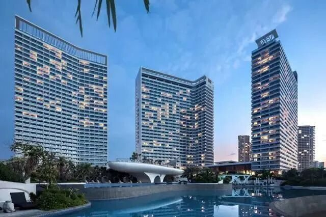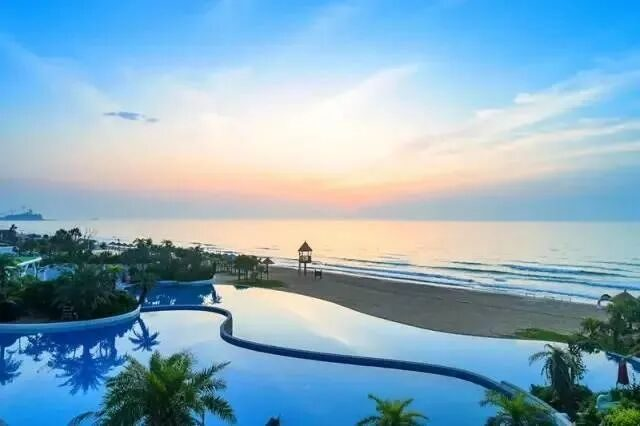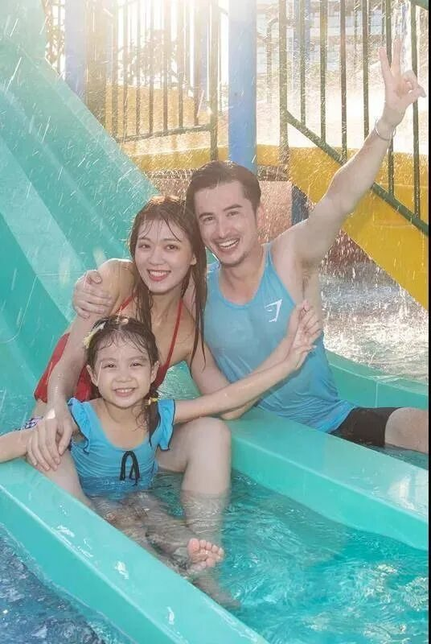
- 近景点：港口镇双月湾度假区，**离海龟湾最近的大酒店**；首日寄存行李即走。
- 方便活动：**私家白沙滩下楼即玩**，无边际泳池 + 31F 空中泳池 + 儿童水乐园，不出酒店就能玩半天。
- 环境卫生：都喜国际集团托管，口碑稳。
- 价格：套餐 **¥578–678**（含 2 大 2 小自助早 + 水乐园 + 豪生海泉），周六 +¥100；OTA 起价 ¥620。
- 房型：天逸高级海景家庭套房 69㎡（2m 大床 + 1.2m 沙发床 + 观海泡池）——1 间住下 2 大 2 小。
- 说明：虽是 5 星，但套餐价已无溢价，按"档次不紧要"口径综合仍排第一。

**② 同区备选 · 檀悦豪生**（5★ · 携程 4.3）

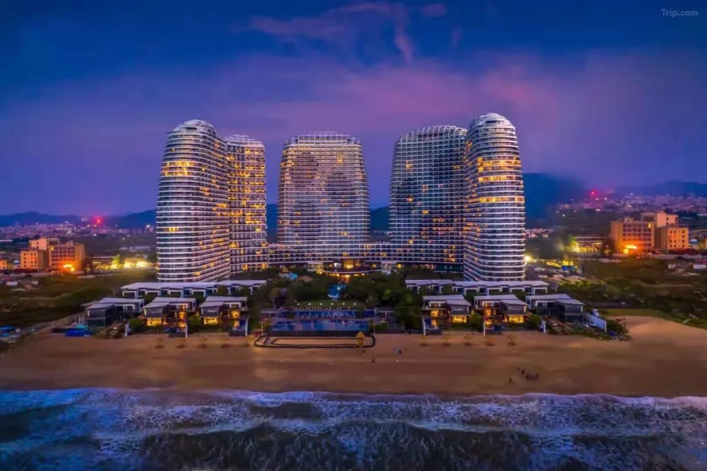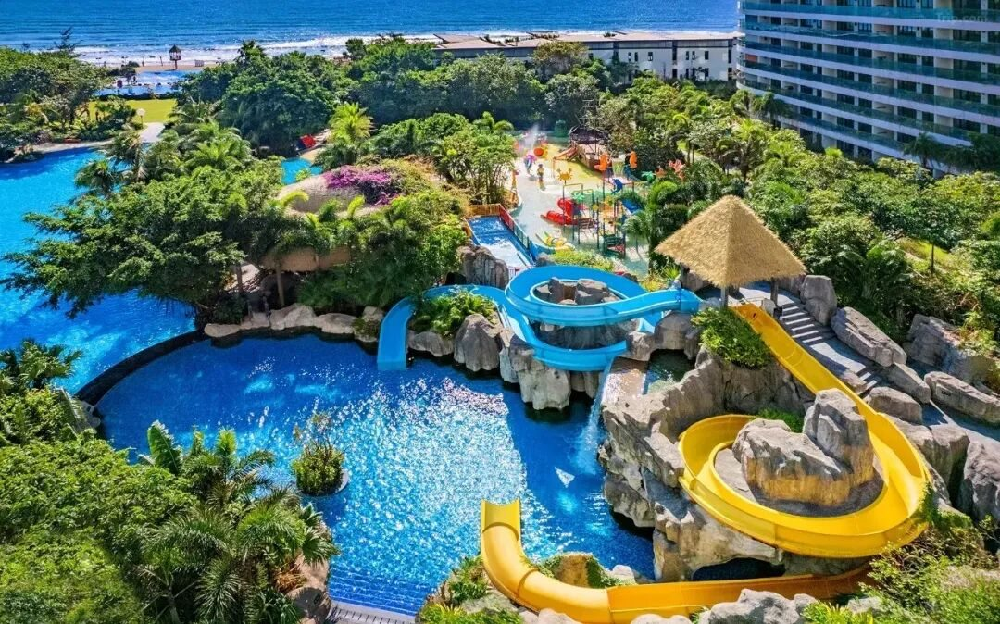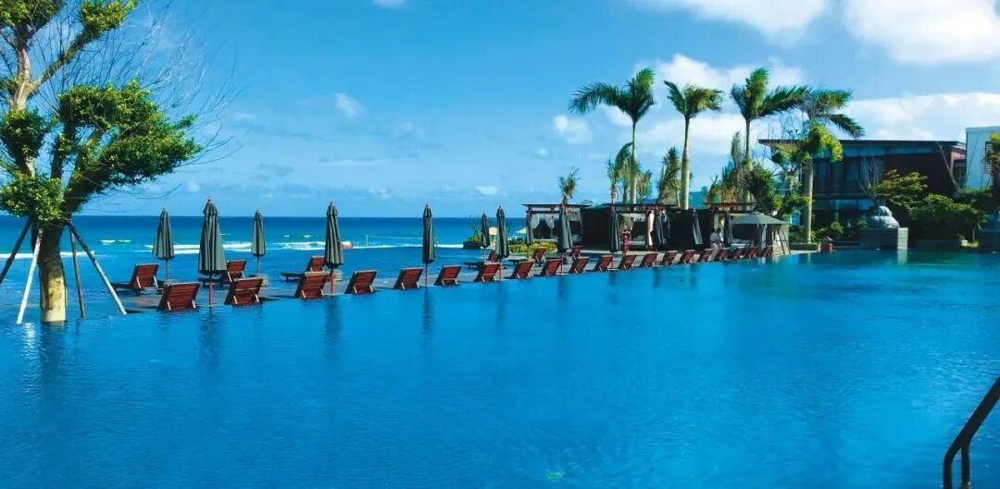
- 与都喜天丽**同度假区、共享配套**；17 个海泉泡池，11 月泡汤最舒服（秋冬之选）；¥638 起；两房一厅亲子套房（上下铺）可住 4 人。

**③ 档次适中 · 近景点**（四星口碑档）

| 酒店 | 口碑 | 位置 / 亮点 | 参考价 |
|------|------|------------|--------|
| 双月湾华美达（温德姆旗下） | 4★ · 4.7 分 | 距双月湾观景台约 1.3km，180° 海景双床房，宜订 2 间；楼下即铂金沙滩，看日落最佳位之一 | 套餐 ¥299 起（含双早，周末不加收） |
| 双月湾半岛酒店 | 4★ · 4.7 分 | 近港口镇觅食方便；海景三床套房 / 两房一厅露台套房，**4 人一间** | 以实时查询为准 |

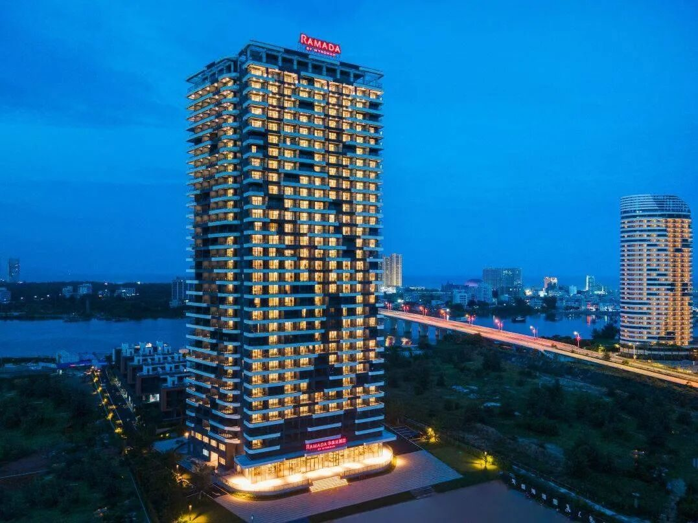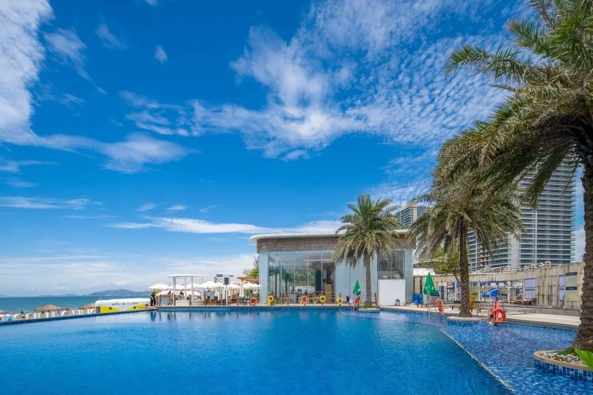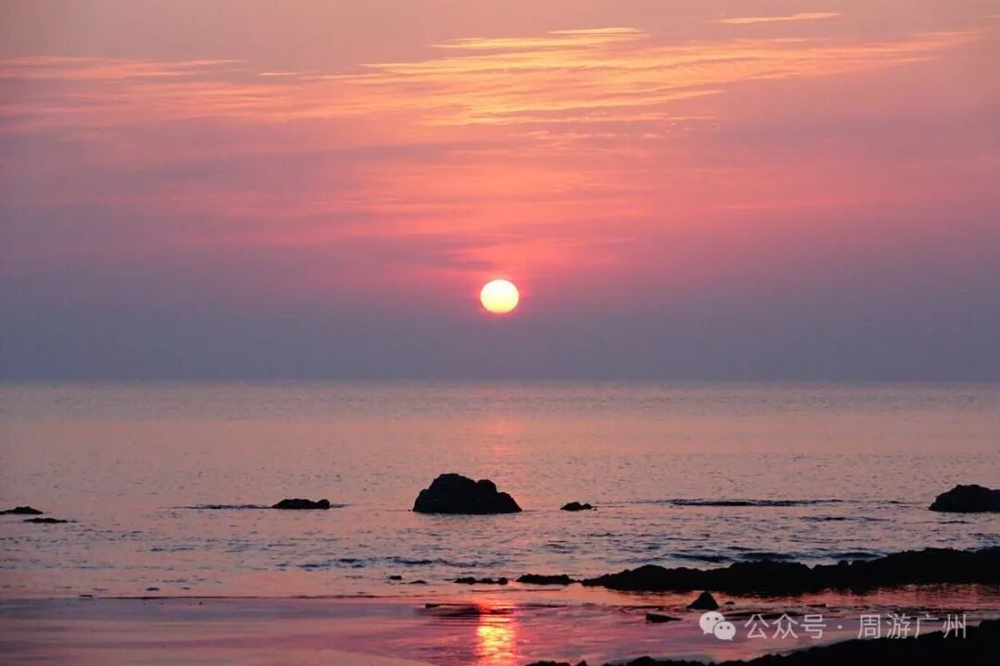

**④ 经济近景区 · 高分干净**（档次不高但卫生口碑好）
| 酒店 | 口碑 | 位置 / 亮点 | 参考价 |
|------|------|------------|--------|
| 后海湾轻奢海景酒店 | 4.7 分 | 港口镇蔡家村，**海龟湾经济型热卖 No.1**；落地窗海景、楼下即沙滩；少量评价提及设施偏旧，订前看近期带图评价 | ¥167 起 |
| 金海假日 | 4.7 分 | 港口镇双月湾新村，亲子家庭房 + 热汤泡池，近港口市场 | ¥198 起 |
| 华海酒店（海龟湾景区店） | 4.9 分 | 大澳村，近观景台 / 情人堤；自带 3D 主题水上乐园，亲子双床房 | 以实时查询为准 |
| 迎光度假酒店 | 4.7 分 | 新寮村，近港口市场 + 海龟湾，觅食方便 | 以实时查询为准 |
| 万科双月湾海景公寓 | 4.7–4.9 分 | 一步沙滩、带厨房加工海鲜；**卫生参差，认准 4.9 分门店**（如"心悦"） | ¥160–300/晚（淡季） |

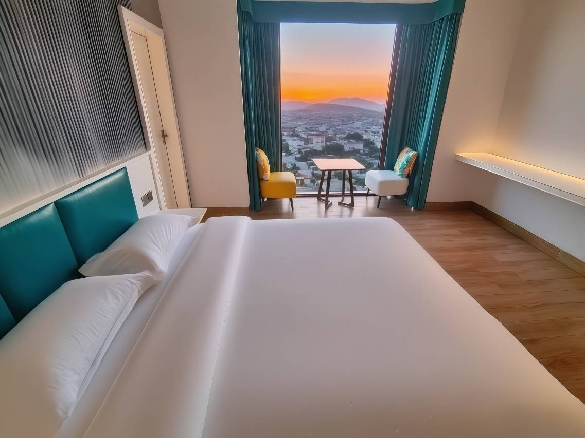

**⑤ 位置权衡（新口径下降级）**

| | |
|---|---|
| 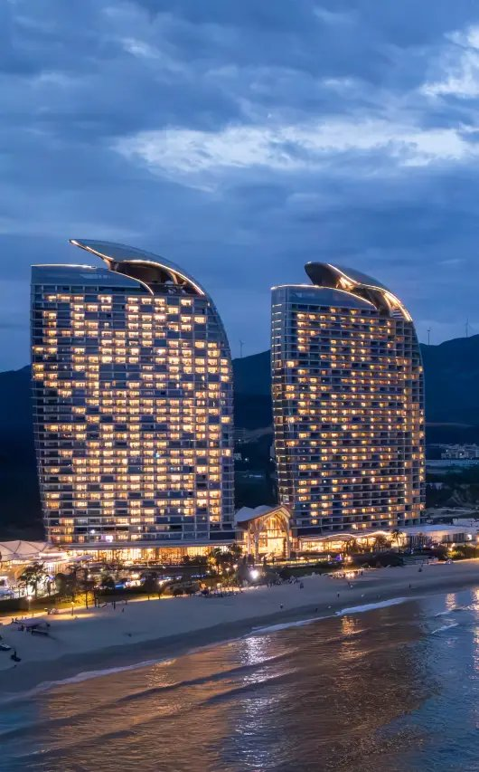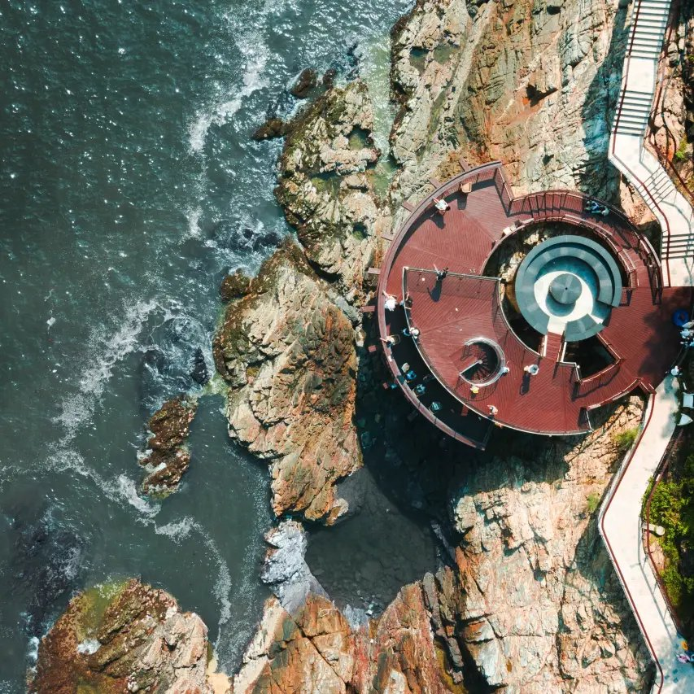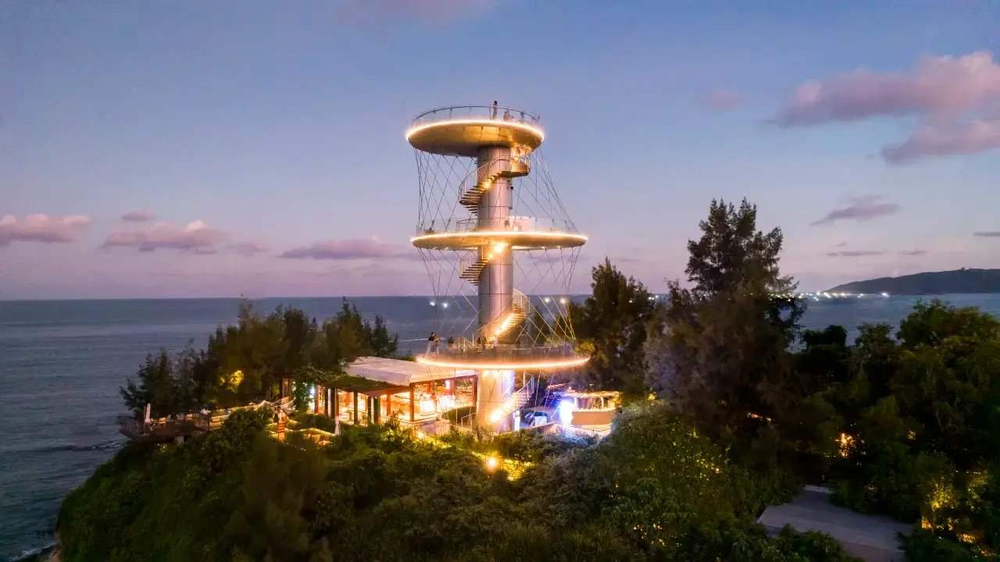 | 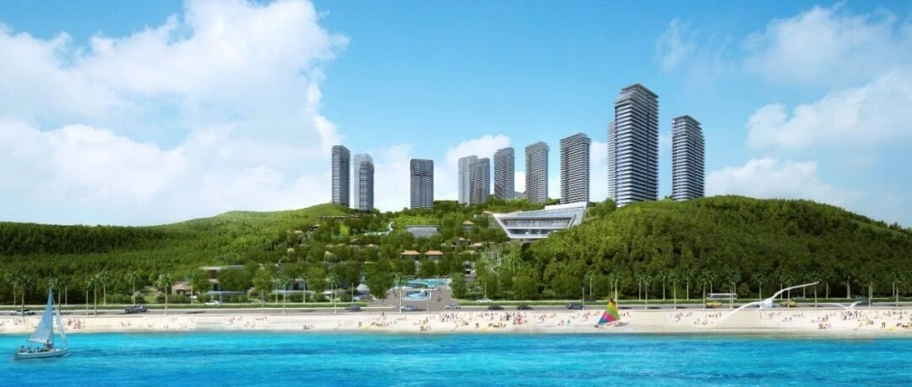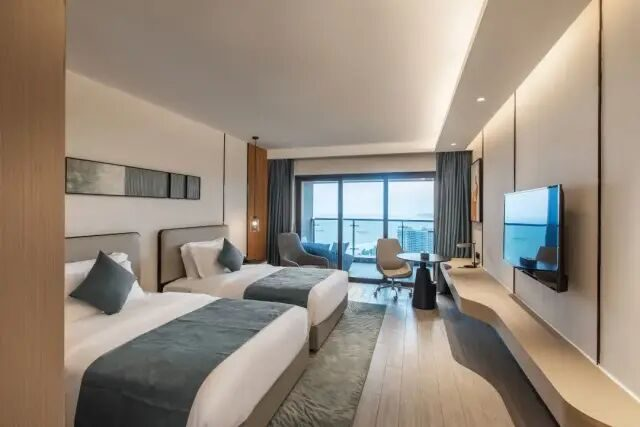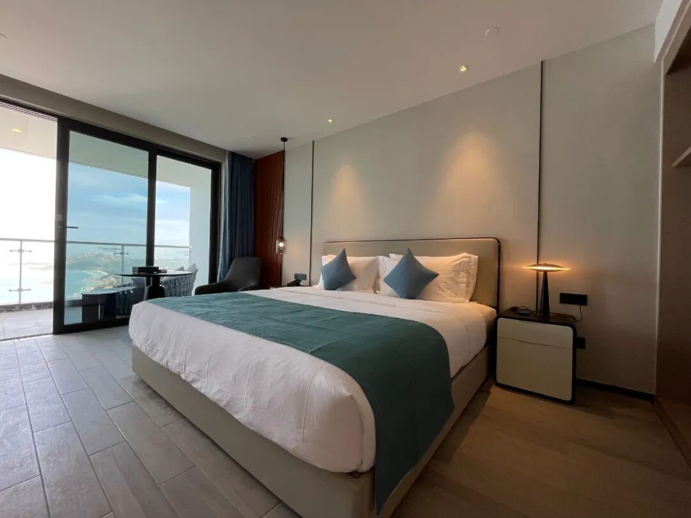 |

- **日出东山海盐晶**（右图左列）：离海龟湾约 6km 车程，"近景点"逊于港口镇；但**住客免门票进情人湾景区（礁石酒吧）**、环境最出片——若 Day2 主打黑排角 / 情人湾可反选它，套餐 ¥899–999 全包。
- **泰丽云顶**（右图右列）：双月湾制高点（一滴水图书馆），但沙滩 / 觅食需电瓶车接驳，**活动便利性最弱**，仅适合纯观景住法；套餐 ¥499–599。

> 📷 图片来源：酒店官方宣传资料及携程图库（2026-11 核实），仅供参考，以实地为准。

### 5.4 预订要点

- **房型策略**：2 大 2 小首选 1 间 69㎡+ 家庭套房（都喜天丽 / 豪生两房一厅），或 2 间标间；订前确认大童早餐 / 加床政策（1.4m 以上多按成人价，自助早 ¥108–128/位、晚 ¥138–198/位）。
- **渠道**：套餐多出自酒店官方公众号 /「要出发」等渠道——**需提前 ≥1 天预约、特价一经预约不退改**；OTA（携程 / 美团）起价 ¥534–789，可退改更灵活。
- **时点**：11–12 月错峰周六普遍 +¥100；多数套票有效期至 2026-12-30 或 2027-01-31，可先囤后约（未预约可退）。

---

## 六、美食清单

- **必吃海鲜**：清蒸石斑、椒盐皮皮虾、蒜蓉生蚝、海鲜粥、海胆炒饭
- **小吃**：平海薄饼、紫菜饼、蚝仔烙、海石花冻（加芒果爆珠）
- **客家菜**：酿豆腐、梅菜扣肉、窑鸡
- **玩法**：港口市场自选鲜活 → 周边餐馆加工（约 ¥10–15/道）

---

## 七、预算估算（2 大 2 小，自驾）

| 项目 | 费用 |
|------|------|
| 交通（油费 + 过路费往返） | ¥300 |
| 住宿 1 晚（轻奢，家庭房 / 2 间） | ¥1,200–2,500 |
| 门票（海龟湾 2 成人¥60 + 2 学生¥30 + 观光车¥80） | ¥170 |
| 餐饮（2 正 + 早 + 小吃，4 人，轻奢略高） | ¥1,000–1,300 |
| 其他（停车 / 零食 / 赶海工具） | ¥200 |
| **合计（轻奢·不含浮潜）** | **≈ ¥2,900–4,500** |
| 加小星山浮潜（¥168×4） | **≈ ¥3,600–5,200** |
| 人均 | 约 ¥700–1,300 |

---

## 八、亲子贴士 & 风险

- **防晒**：每 2 小时补涂，遮阳帽 + 墨镜；16:00 前结束暴晒戏水
- **安全**：栈道穿防滑鞋；海龟馆**禁用闪光灯**；不投喂、不触碰海龟
- **赶海**：查潮汐（「全球潮汐」APP / 微信「潮汐精灵」），穿防滑鞋，不进深水区
- **预约**：周末巽寮湾大桥易堵，早出发；海龟湾、礁石酒吧需提前官方渠道预约
- **浮潜**：选正规俱乐部（小星山），儿童/青少年须成人陪同，避开正午

---

## 九、待定模块（出发前再拍板，均为可插拔选项）

- ✅ **预算档位：已定为轻奢（酒店）**
- ⬜ **Day2 主线**：A 平海古城（文化） / B 盐洲岛红树林（自然·推荐） / 两者都去（偏紧）
- ⬜ **是否加小星山浮潜**：大孩子升级项，¥168/人
- ⬜ **是否加礁石酒吧 / 一滴水图书馆**：网红打卡，需提前预约
- ⬜ **具体周末日期**：定后我补潮汐表、海龟湾车位预约与（若有）幼龟放流场次

> 💡 **2026-11 情报补充**：上述「礁石酒吧」位于日出东山海度假区（住**盐晶酒店**免门票入园）；「一滴水图书馆」在**泰丽云顶**（住店无限次畅玩）——住宿选择可直接省掉这两项门票，详见第五节 5.1。

---

## 十、审核通过后的下一步

- 转化为「四季景点」子站下的《惠东周末家庭游》长文页，沿用仓库 `brand/top-nav-template.html` 固定顶部章节导航模板
- 页面含：封面图、章节导航、地图示意、住宿 / 美食卡片、潮汐与预约提示、亲子 Checklist
- 配图用双月湾 / 海龟湾实拍，需补充版权合规图片素材
